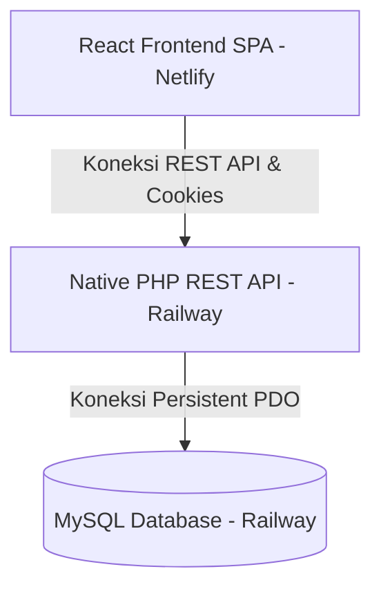

# **Studi Kasus Portofolio: GAS Website (Green Action Students)**
### *Full-Stack Sustainability E-Learning & Gamified Platform*

---

## **Ringkasan Proyek**
**GAS (Green Action Students)** adalah platform edukasi digital interaktif yang dirancang untuk memandu siswa dan guru dalam pembelajaran keberlanjutan lingkungan, khususnya dalam proyek pembuatan **Ekoenzim** (fermentasi limbah organik) serta implementasi **Kimia Hijau (Green Chemistry)**. Platform ini mengusung pendekatan gamifikasi dengan fitur pelacakan progress tugas terstruktur (LKM), galeri video kreasi siswa (EcoCreation), forum evaluasi interaktif (EcoChallenge), presensi harian (Daily Check-in) dengan akumulasi poin, serta leaderboard kompetitif.

*   **Peran:** Full-Stack Developer
*   **Waktu Pengerjaan:** 2026
*   **Tautan Repositori:** `https://github.com/Wezz2806/gas-website`
*   **Teknologi:** React 19, TypeScript, Vite, Tailwind CSS, Native PHP 8.2 (REST API), MySQL/MariaDB, Docker, Netlify, Railway.

---

## **Latar Belakang & Masalah**
Pendidikan lingkungan di sekolah seringkali hanya bersifat teoritis dan kurang mendorong tindakan nyata (sustainable action). Siswa kesulitan memantau perkembangan praktikum mandiri mereka (seperti fermentasi ekoenzim yang memakan waktu 3 bulan), kurang memiliki ruang untuk berbagi inovasi secara kreatif, dan kurang termotivasi untuk konsisten belajar secara berkelanjutan.

**Kebutuhan Utama:**
1.  Sistem terstruktur untuk memandu praktikum bertahap dari pertemuan awal hingga pelabelan produk.
2.  Sistem berbagi inovasi lingkungan (video pendek) yang dinamis dan terintegrasi dalam platform sekolah.
3.  Elemen gamifikasi (Eco-Points, Leaderboard, dan Streak harian) untuk meningkatkan *user engagement*.
4.  Arsitektur terpisah (decoupled) antara frontend SPA (Single Page Application) yang responsif dengan backend API yang aman.

---

## **Arsitektur Sistem & Solusi Teknis**
Proyek ini mengadopsi arsitektur **decoupled** untuk memisahkan beban kerja antarmuka pengguna dengan pemrosesan data, guna meningkatkan skalabilitas, kecepatan pemuatan halaman, dan keamanan.



### **1. Frontend Stack (Client-Side)**
*   **React 19 & TypeScript**: Menjamin pengetikan data yang aman (type-safe) dan pemeliharaan kode jangka panjang.
*   **Vite**: Menyediakan kompilasi cepat serta modularitas tinggi dengan *code splitting* (`React.lazy` & `Suspense`) untuk performa rendering optimal.
*   **Tailwind CSS**: Desain UI modern dengan palet warna natural (Forest Green, Cream, Light Amber) yang responsif untuk berbagai ukuran perangkat.
*   **Motion**: Memberikan transisi halaman dan efek mikro-interaksi yang dinamis pada komponen visual.

### **2. Backend Stack (Server-Side)**
*   **Native PHP 8.2 REST API**: Dibangun menggunakan arsitektur modular tanpa framework berat, memberikan performa eksekusi yang sangat cepat dan kontrol penuh atas manipulasi header HTTP.
*   **Sesi Lintas Domain (Cross-Origin Session)**: Mengonfigurasi parameter cookie sesi PHP secara dinamis dengan opsi `SameSite=None`, `Secure`, dan `HttpOnly` untuk menjamin otentikasi aman antara frontend di Netlify and backend di Railway.
*   **PHPMailer & Google OAuth**: Integrasi alur masuk satu klik akun Google serta pengiriman kode OTP untuk pemulihan kata sandi.

### **3. Database Stack (Storage)**
*   **MySQL**: Skema database relasional 10 tabel terindeks yang mengoptimalkan query pencarian leaderboard, filter status tugas LKM, serta daftar tayangan video inovasi.

---

## **Fitur Utama & Implementasi**

### **1. Sistem Otentikasi Ganda & Sesi Aman**
Menyediakan metode pendaftaran konvensional serta integrasi **Google Sign-In API**. Sesi pengguna dipertahankan menggunakan session PHP yang dikirim via cookie terenkripsi lintas domain (CORS). Fitur lupa password diakomodasi dengan sistem OTP 6-digit yang kedaluwarsa secara otomatis dalam 15 menit.

### **2. Dasbor Gamifikasi & Leaderboard**
*   **Daily Check-in**: Siswa dapat mengklaim **+20 Eco-Points** setiap 24 jam. Sistem secara otomatis menghitung *streak* login beruntun untuk memacu kebiasaan belajar siswa.
*   **Leaderboard Real-Time**: Query MySQL terindeks menyusun peringkat siswa berdasar skor akumulatif secara efisien.

### **3. EcoLab: Sistem Pengumpulan Lembar Kerja Mahasiswa (LKM)**
Menyediakan alur praktikum terstruktur dalam 4 fase. Siswa dapat mengunduh format lembar kerja dari Google Drive, mengerjakannya, dan mengunggah laporan (PDF/DOCX/PPTX) secara langsung. 
*   **Fitur Re-Upload & Delete**: Memungkinkan siswa merevisi tugas sebelum dinilai.
*   **Feedback System**: Guru dapat memberikan nilai kuantitatif (0-100) dan catatan evaluasi kualitatif yang langsung tersinkronisasi di UI siswa.

### **4. EcoCreation: Galeri Video Kreatif Siswa**
Kliping video pendek buatan siswa yang mendokumentasikan inovasi lingkungan.
*   **Deteksi Durasi Otomatis**: Memanfaatkan API media browser pada sisi client saat file video dipilih, membebaskan siswa dari keharusan menginput durasi secara manual.
*   **Video Streaming Engine**: API backend PHP memproses streaming file video berukuran besar secara modular guna menghemat bandwidth server.
*   **Social Interactions**: Fitur menyukai (like), melihat (view count), serta menulis komentar diskusi di setiap video.

### **5. EcoChallenge: Forum Diskusi & Posttest**
Integrasi posttest berbasis Google Form serta ruang diskusi kelas. Siswa dapat mengomentari umpan balik guru, melakukan edit komentar secara *inline* (tanpa memuat ulang halaman), dan menghapus komentar yang ditulisnya sendiri.

---

## **Tantangan Teknis & Solusi**

### **Tantangan 1: Mengatasi Masalah CORS & Sesi Hilang Lintas Domain (Cross-Origin)**
*   **Masalah:** Saat frontend dideploy di Netlify (`https://gaslearn.netlify.app`) dan backend di Railway (`https://api.railway.app`), browser memblokir penyimpanan cookie sesi PHP karena batasan kebijakan Same-Site. Akibatnya, pengguna selalu ter-logout setiap kali halaman disegarkan.
*   **Solusi:** Saya mengonfigurasi setelan server backend PHP agar mendeteksi origin secara dinamis, mengembalikan header CORS yang tepat, dan memodifikasi parameter sesi cookie PHP saat inisialisasi:
    ```php
    session_set_cookie_params([
        'lifetime' => 86400 * 7,
        'path'     => '/',
        'secure'   => true, // Wajib HTTPS
        'httponly' => true, // Melindungi dari serangan XSS
        'samesite' => 'None', // Mengizinkan pengiriman cookie lintas domain
    ]);
    ```

### **Tantangan 2: Deteksi Durasi Video secara Akurat di Sisi Klien**
*   **Masalah:** Meminta pengguna memasukkan durasi video secara manual seringkali menghasilkan data yang tidak valid. Di sisi lain, memproses berkas video di server PHP hanya untuk mengambil durasi membutuhkan CPU load yang tinggi (misal menggunakan library FFmpeg).
*   **Solusi:** Saya merancang pustaka pendeteksi durasi berbasis Javascript pada frontend React dengan memanfaatkan metadata objek video HTML5 sebelum berkas diunggah:
    ```javascript
    const calculateDuration = (file, callback) => {
      const videoEl = document.createElement('video');
      videoEl.preload = 'metadata';
      videoEl.onloadedmetadata = () => {
        window.URL.revokeObjectURL(videoEl.src);
        const durationSecs = videoEl.duration;
        const minutes = Math.floor(durationSecs / 60);
        const seconds = Math.floor(durationSecs % 60);
        callback(`${minutes.toString().padStart(2, '0')}:${seconds.toString().padStart(2, '0')}`);
      };
      videoEl.src = URL.createObjectURL(file);
    };
    ```

### **Tantangan 3: Optimasi Pengiriman File Berukuran Besar (Maksimal 100MB)**
*   **Masalah:** Batasan unggah default PHP (2MB) menyebabkan proses unggah video gagal.
*   **Solusi:** Saya membuat Dockerfile khusus untuk Railway yang mengesampingkan nilai default PHP saat runtime:
    ```dockerfile
    CMD php -d upload_max_filesize=100M -d post_max_size=110M -d memory_limit=256M -S 0.0.0.0:${PORT:-80} -t /app
    ```

---

## **Hasil & Dampak Belajar**
*   **Pemahaman Arsitektur Decoupled**: Memperkuat pemahaman saya mengenai integrasi backend-frontend terpisah dan bagaimana merancang REST API yang aman dan efisien.
*   **Keamanan Aplikasi Web**: Mempelajari penanganan sanitasi input PHP PDO untuk mencegah SQL Injection, serta pengamanan cookie sesi terhadap ancaman pencurian sesi (Session Hijacking).
*   **Manajemen Aset Statis**: Mengimplementasikan streaming video berbasis server serta manajemen berkas unggahan di sistem file lokal secara terorganisir.
*   **Gamifikasi UI/UX**: Berhasil mendesain antarmuka bertema lingkungan dengan visual premium yang mendorong interaksi aktif siswa melalui poin dan peringkat.
