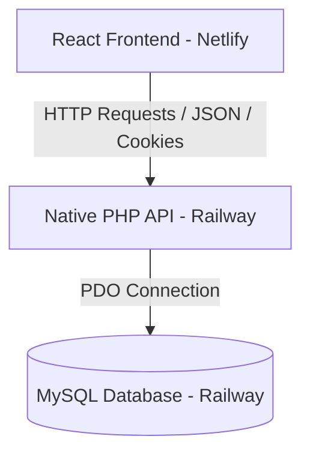
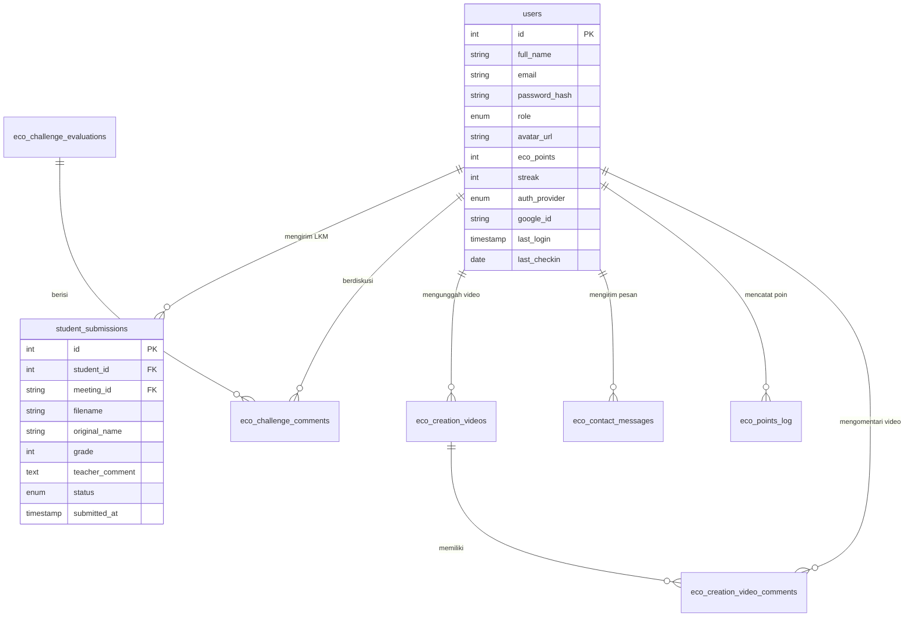

# Dokumen Spesifikasi Sistem (System Specification Document)
## **GAS Website — Green Action Students**
*Dari Pengetahuan ke Aksi Berkelanjutan (From Knowledge to Sustainable Action)*

Dokumen ini berisi penjelasan spesifikasi teknis lengkap dari platform **GAS Website**, sebuah platform edukasi keberlanjutan lingkungan yang dirancang untuk murid dan guru. Dokumen ini ditujukan kepada pengembang, pengajar, maupun administrator sistem untuk memahami arsitektur, skema basis data, alur kerja sistem, fungsionalitas modul, serta antarmuka API yang tersedia.

---

## **Daftar Isi**
1. [Deskripsi Umum & Tujuan](#1-deskripsi-umum--tujuan)
2. [Arsitektur Sistem & Stack Teknologi](#2-arsitektur-sistem--stack-teknologi)
3. [Spesifikasi Basis Data (Database Schema)](#3-spesifikasi-basis-data-database-schema)
4. [Spesifikasi Fungsional Modul (Murid)](#4-spesifikasi-fungsional-modul-murid)
5. [Spesifikasi API Endpoint (Backend PHP)](#5-spesifikasi-api-endpoint-backend-php)
6. [Struktur Direktori Proyek](#6-struktur-direktori-proyek)
7. [Panduan Instalasi & Deployment Lokal](#7-panduan-instalasi--deployment-lokal)

---

## **1. Deskripsi Umum & Tujuan**

**Green Action Students (GAS) Website** adalah aplikasi web interaktif yang dikembangkan untuk memfasilitasi pembelajaran keberlanjutan lingkungan secara kolaboratif. Fokus utama dari platform ini adalah memandu murid dalam proyek pembuatan **Ekoenzim** (fermentasi limbah kulit buah organik menjadi cairan serbaguna) serta penerapan **Kimia Hijau (Green Chemistry)**.

Platform ini mengintegrasikan:
*   **Pembelajaran Mandiri (E-Learning)**: Membaca materi digital secara interaktif.
*   **Lembar Kerja Murid/Murid (LKM)**: Mengunduh panduan praktikum dan mengunggah laporan praktikum bertahap.
*   **Kolaborasi Kreatif**: Berbagi inovasi lingkungan dalam bentuk video pendek.
*   **Gamifikasi Terintegrasi**: Mengumpulkan Eco-Points, mempertahankan Streak harian, dan bersaing di Leaderboard.
*   **Evaluasi Guru**: Mengerjakan kuis/test dan berdiskusi di forum evaluasi.

---

## **2. Arsitektur Sistem & Stack Teknologi**

Platform GAS menggunakan arsitektur **decoupled** (terpisah) antara antarmuka pengguna (Frontend) dengan server logika data (Backend REST API).



### **A. Stack Teknologi Frontend**
*   **Core**: React 19 (TypeScript) & Vite.
*   **Desain & Styling**: Tailwind CSS v4, Montserrat (Heading), Inter (Body).
*   **Ikonografi & Visual**: Lucide React Icons.
*   **Animasi UI**: Motion (Framer Motion) untuk transisi halaman yang mulus.
*   **Otentikasi & Sesi**: React Context (`AuthContext`) terintegrasi dengan cookies & backend PHP session.
*   **Deployment**: Dihosting di **Netlify** dengan file konfigurasi `netlify.toml` untuk rewrite rute SPA.

### **B. Stack Teknologi Backend**
*   **Bahasa Pemrograman**: Native PHP 8.2 (Object-Oriented & PDO).
*   **Keamanan Sesi**: Cookie berbasis `HttpOnly`, `Secure`, dan `SameSite=None` untuk mendukung pertukaran sesi lintas domain (cross-origin).
*   **Pengiriman Email**: PHPMailer untuk layanan pengiriman OTP lupa sandi.
*   **Otentikasi Google**: Integrasi Google Client Library untuk sistem Sign-in Google.
*   **Deployment**: Menggunakan Docker container (`Dockerfile`) dideploy di **Railway**, berjalan di PHP CLI built-in server dengan konfigurasi upload file hingga 100MB.

### **C. Basis Data (Database)**
*   **Sistem Manajemen**: MySQL / MariaDB.
*   **Koneksi**: PDO MySQL dengan mode persistent connection.

---

## **3. Spesifikasi Basis Data (Database Schema)**

Hubungan antar tabel dalam basis data `gas_website` dirancang menggunakan skema relasional terindeks.

### **Diagram Hubungan Entitas (Entity Relationship Diagram)**



### **Detail Struktur Tabel**

#### **1. Tabel `users`**
Menyimpan data pengguna (murid, guru, dan admin).
| Field | Tipe Data | Nullable | Default | Keterangan |
| :--- | :--- | :--- | :--- | :--- |
| `id` | INT | No | *Auto-Increment* | Primary Key |
| `full_name` | VARCHAR(100) | No | | Nama lengkap pengguna |
| `email` | VARCHAR(150) | No | | Email unik pengguna |
| `password_hash` | VARCHAR(255) | Yes | NULL | Hash password (kosong jika login Google) |
| `role` | ENUM('student', 'teacher', 'admin') | No | 'student' | Hak akses sistem |
| `avatar_url` | VARCHAR(500) | Yes | NULL | URL foto profil pengguna |
| `eco_points` | INT | No | 0 | Skor gamifikasi lingkungan |
| `streak` | INT | No | 0 | Jumlah check-in berturut-turut |
| `auth_provider` | ENUM('local', 'google') | No | 'local' | Metode otentikasi akun |
| `google_id` | VARCHAR(255) | Yes | NULL | ID unik Google OAuth |
| `last_login` | TIMESTAMP | Yes | NULL | Waktu login terakhir |
| `last_checkin` | DATE | Yes | NULL | Tanggal check-in terakhir (untuk streak harian) |
| `created_at` | TIMESTAMP | No | CURRENT_TIMESTAMP | Waktu pendaftaran akun |
| `updated_at` | TIMESTAMP | No | CURRENT_TIMESTAMP | Diperbarui otomatis saat baris dimodifikasi |

> [!NOTE]
> Indeks khusus ditambahkan pada: `email`, `role`, `eco_points` (DESC - untuk leaderboard), dan `auth_provider` guna mempercepat pencarian data.

#### **2. Tabel `password_resets`**
Menampung kode OTP untuk verifikasi atur ulang kata sandi.
| Field | Tipe Data | Nullable | Default | Keterangan |
| :--- | :--- | :--- | :--- | :--- |
| `id` | INT | No | *Auto-Increment* | Primary Key |
| `email` | VARCHAR(150) | No | | Email target |
| `otp_code` | VARCHAR(6) | No | | Kode verifikasi 6 digit |
| `expires_at` | TIMESTAMP | No | | Waktu kedaluwarsa kode |
| `used` | TINYINT(1) | No | 0 | Status kode (1 = Terpakai, 0 = Belum) |
| `created_at` | TIMESTAMP | No | CURRENT_TIMESTAMP | Waktu pengajuan OTP |

#### **3. Tabel `student_submissions`**
Menyimpan berkas LKM yang dikumpulkan murid serta nilainya.
| Field | Tipe Data | Nullable | Default | Keterangan |
| :--- | :--- | :--- | :--- | :--- |
| `id` | INT | No | *Auto-Increment* | Primary Key |
| `student_id` | INT | No | | Foreign Key -> `users.id` (ON DELETE CASCADE) |
| `meeting_id` | VARCHAR(10) | No | | Kode pertemuan (m1, m2, m3, m4) |
| `filename` | VARCHAR(255) | No | | Nama file terenkripsi unik di server |
| `original_name` | VARCHAR(255) | No | | Nama file asli unggahan murid |
| `grade` | TINYINT UNSIGNED | Yes | NULL | Nilai tugas (0 - 100) dari guru |
| `teacher_comment` | TEXT | Yes | NULL | Komentar evaluasi dari pengajar |
| `status` | ENUM('pending', 'graded') | No | 'pending' | Status peninjauan tugas |
| `submitted_at` | TIMESTAMP | No | CURRENT_TIMESTAMP | Waktu pengiriman tugas |
| `graded_at` | TIMESTAMP | Yes | NULL | Waktu pemberian nilai |

#### **4. Tabel `meetings`**
Mendokumentasikan sesi pertemuan/timeline praktikum ekoenzim.
| Field | Tipe Data | Nullable | Default | Keterangan |
| :--- | :--- | :--- | :--- | :--- |
| `id` | VARCHAR(10) | No | | Primary Key (misal: 'm1', 'm2') |
| `number` | TINYINT | No | | Urutan pertemuan |
| `title` | VARCHAR(200) | No | | Judul modul pertemuan |
| `description` | TEXT | Yes | | Deskripsi praktikum |
| `icon` | VARCHAR(50) | No | 'science' | Nama ikon Lucide |
| `status` | ENUM('completed', 'ongoing', 'scheduled') | No | 'scheduled' | Status progress pertemuan |
| `updated_at` | TIMESTAMP | No | CURRENT_TIMESTAMP | Diperbarui otomatis saat baris diubah |

#### **5. Tabel `eco_creation_videos`**
Berisi unggahan video karya inovasi kreatif murid.
| Field | Tipe Data | Nullable | Default | Keterangan |
| :--- | :--- | :--- | :--- | :--- |
| `id` | INT | No | *Auto-Increment* | Primary Key |
| `student_id` | INT | No | | Foreign Key -> `users.id` (ON DELETE CASCADE) |
| `title` | VARCHAR(300) | No | | Judul video inovasi |
| `category` | VARCHAR(100) | No | 'Umum' | Kategori video (misal: Sains Rumah, Robotik) |
| `duration` | VARCHAR(10) | Yes | NULL | Durasi video dalam format MM:SS |
| `filename` | VARCHAR(255) | No | | Nama file video unik di folder uploads |
| `original_name` | VARCHAR(255) | No | | Nama asli file video |
| `status` | ENUM('pending', 'approved', 'rejected') | No | 'pending' | Status publikasi |
| `reject_reason` | VARCHAR(500) | Yes | NULL | Catatan penolakan video |
| `views` | INT | No | 0 | Akumulasi jumlah tayangan video |
| `likes` | INT | No | 0 | Akumulasi jumlah penyuka video |
| `submitted_at` | TIMESTAMP | No | CURRENT_TIMESTAMP | Tanggal unggah video |
| `approved_at` | TIMESTAMP | Yes | NULL | Waktu video disetujui untuk galeri umum |

---

## **4. Spesifikasi Fungsional Modul (Murid)**

### **A. Modul Otentikasi & Pengaturan Pengguna**
*   **Registrasi & Login**: Otentikasi menggunakan email & kata sandi dengan verifikasi lokal, atau menggunakan akun Google (OAuth 2.0).
*   **Lupa Sandi (OTP)**: Murid meminta OTP verifikasi yang dikirim ke email mereka via PHPMailer untuk mereset sandi.
*   **Pengaturan Profil**: Mengubah nama lengkap, foto profil (avatar), mengubah kata sandi lama, serta opsi menghapus avatar secara permanen.

### **B. Dashboard Utama (Pusat Kendali)**
*   **Eco-Points & Streak**: Menampilkan jumlah poin terkumpul dan jumlah hari beruntun murid masuk ke web.
*   **Presensi Harian (Daily Check-in)**: Tombol sekali sehari untuk klaim bonus +20 Eco-Points.
*   **Leaderboard**: Peringkat seluruh murid berdasarkan total Eco-Points secara *real-time*.
*   **Sekilas Progress Proyek**: Menunjukkan status penyelesaian LKM dari 4 pertemuan.
*   **Berita Lingkungan Lokal**: Menampilkan ringkasan berita lingkungan terpopuler di Surabaya & nasional.

### **C. EcoPedia (Perpustakaan Digital)**
*   **Koleksi Buku**: Menyediakan buku modul PDF seperti *Kimia Hijau & Keberlanjutan* dan *Ekoenzim: Limbah Jadi Sumber Daya*.
*   **Pembaca Materi Terintegrasi**: Fitur pratinjau materi dengan rangkuman informasi buku secara langsung di web tanpa harus keluar aplikasi.
*   **Pencarian Buku**: Kolom cari teks yang memfilter buku secara instan.

### **D. EcoLab (Praktikum & LKM)**
*   **Pertemuan Terjadwal**: Timeline berisi 4 fase pertemuan proyek Ekoenzim:
    1.  *Meeting 1: Kickoff & Pengadaan*
    2.  *Meeting 2: Kontrol Proses (Pemantauan pH)*
    3.  *Meeting 3: Persiapan Enzim Aktif (Pemanenan)*
    4.  *Meeting 4: Pengemasan Produk (Kontrol Kualitas)*
*   **Unduh LKM**: Tombol unduh panduan worksheet resmi yang langsung terhubung ke Google Drive.
*   **Unggah LKM**: Modul drag-and-drop file pendukung PDF/DOCX/PPTX (Maks 10MB) per pertemuan.
*   **Umpan Balik Guru**: Notifikasi jika file telah dinilai beserta masukan tertulis dari pengajar. Murid dapat menghapus tugas yang sudah diunggah untuk mengunggah ulang tugas baru.

### **E. EcoUpdate (Kliping Berita Lingkungan)**
*   **Portal Berita Lengkap**: Menyajikan artikel edukasi lingkungan (misal: "Deklarasi She Heroes", "Sampah Mikroplastik Air Hujan Surabaya").
*   **Pencarian Artikel**: Fitur cari berita terintegrasi.
*   **Interaksi Sosial**: Fitur untuk menyukai (like) artikel dan navigasi langsung ke tautan berita asli.

### **F. EcoCreation (Galeri Inovasi Video)**
*   **Galeri Publik**: Kumpulan video inovasi sains ramah lingkungan buatan murid.
*   **Unggah Video Instan**: Murid mengunggah berkas video (MP4/MOV/AVI) dengan deteksi durasi otomatis pada web.
*   **Putar Video**: Pemutar video terintegrasi (HTML5 Video Stream) yang merekam data tayangan (views).
*   **Interaksi Galeri**: Murid dapat menyukai (like) video teman lain, membaca komentar, serta menulis komentar baru.
*   **Manajemen Karya Sendiri**: Khusus video miliknya, murid dapat mengedit judul, mengganti file video, atau menghapus video tersebut kapan saja.

### **G. EcoChallenge (Test & Diskusi Kelas)**
*   **Test Evaluasi**: Tautan terintegrasi ke form ujian akhir (Google Form).
*   **Evaluasi Pengajar**: Catatan evaluasi akhir resmi dari guru pengampu kelas.
*   **Forum Tanggapan Murid**: Ruang bagi murid untuk menulis diskusi kelas, bertanya, mengedit tanggapan, atau menghapus tanggapannya sendiri secara mandiri.

---

## **5. Spesifikasi API Endpoint (Backend PHP)**

Semua endpoint API terletak di direktori `/api/` dan mengembalikan respons berformat JSON dengan header CORS terenkripsi.

### **A. API Otentikasi & Sesi**
*   `POST /api/register.php`
    *   *Fungsi*: Mendaftarkan akun murid baru.
    *   *Parameter*: `full_name`, `email`, `password`.
*   `POST /api/login.php`
    *   *Fungsi*: Validasi kredensial lokal dan membuat sesi pengguna.
    *   *Parameter*: `email`, `password`.
*   `POST /api/google-auth.php`
    *   *Fungsi*: Otentikasi satu klik menggunakan Google Login Token.
    *   *Parameter*: `credential` (Token OAuth).
*   `GET /api/session.php`
    *   *Fungsi*: Mengambil data sesi pengguna yang sedang login saat memuat web pertama kali.
*   `POST /api/logout.php`
    *   *Fungsi*: Menghapus sesi di server dan menghapus cookie otentikasi.
*   `POST /api/forgot-password.php`
    *   *Fungsi*: Mengirimkan kode verifikasi OTP 6 digit ke alamat email pengguna.
*   `POST /api/reset-password.php`
    *   *Fungsi*: Mengubah password lama dengan password baru menggunakan kode OTP.

### **B. API Aktivitas & Profil**
*   `POST /api/checkin.php`
    *   *Fungsi*: Klaim poin check-in harian. Memperbarui `eco_points` (+20) dan `streak` pengguna.
*   `POST /api/update-profile.php`
    *   *Fungsi*: Mengubah profil pengguna (nama, ganti avatar via upload berkas JPG/PNG, ubah kata sandi, atau hapus foto profil).

### **C. API EcoLab (Submissions)**
*   `GET /api/get-submissions.php`
    *   *Fungsi*: Mengambil semua daftar berkas LKM yang pernah dikumpulkan oleh murid yang sedang login.
*   `POST /api/upload-submission.php`
    *   *Fungsi*: Mengunggah file LKM untuk pertemuan tertentu.
    *   *Parameter*: `meeting_id` (m1/m2/m3/m4) & file upload (`lkm_file`).
*   `POST /api/delete-submission.php`
    *   *Fungsi*: Menghapus file laporan LKM di server dan database berdasarkan ID pertemuan.

### **D. API EcoCreation (Video)**
*   `GET /api/get-videos.php`
    *   *Fungsi*: Menampilkan seluruh daftar video yang disetujui di galeri umum.
*   `POST /api/upload-video.php`
    *   *Fungsi*: Mengunggah video inovasi baru ke server.
    *   *Parameter*: `title`, `category`, `duration`, & file video (`video_file`).
*   `POST /api/edit-video.php`
    *   *Fungsi*: Mengubah data video (judul, kategori, atau opsi unggah file video baru pengganti).
*   `POST /api/delete-video.php`
    *   *Fungsi*: Menghapus video di server dan database secara permanen.
*   `POST /api/like-video.php`
    *   *Fungsi*: Menambahkan 1 poin like pada video terpilih.
*   `GET /api/stream-video.php`
    *   *Fungsi*: Melakukan streaming video (baca file video dari server dan kirim sebagai response stream mp4).

### **E. API Diskusi & Komentar**
*   `GET /api/get-comments.php`
    *   *Fungsi*: Mengambil daftar diskusi murid pada modul EcoChallenge.
*   `POST /api/add-comment.php`
    *   *Fungsi*: Menambahkan tanggapan/diskusi baru.
*   `POST /api/edit-comment.php`
    *   *Fungsi*: Mengubah konten komentar milik murid bersangkutan.
*   `POST /api/delete-comment.php`
    *   *Fungsi*: Menghapus komentar diskusi murid bersangkutan.

---

## **6. Struktur Direktori Proyek**

Berikut adalah struktur folder utama dari proyek **GAS Website**:

```text
GAS Website/
│
├── api/                       # API Backend (PHP Native)
│   ├── config.php             # Pengaturan DB, CORS, Sesi, & Migrasi Otomatis
│   ├── session.php            # Manajemen validasi sesi aktif
│   ├── login.php              # Logika login pengguna
│   ├── checkin.php            # Logika daily check-in
│   ├── upload-submission.php  # Upload berkas LKM (EcoLab)
│   ├── upload-video.php       # Upload berkas video (EcoCreation)
│   ├── stream-video.php       # Layanan stream video mp4
│   └── teacher/               # REST API khusus fungsi Guru (grading, stats, etc)
│
├── database/                  # Skrip Inisialisasi Basis Data
│   ├── schema.sql             # Skema tabel lengkap (Revisi 2)
│   └── gas_website.sql        # Backup data database awal
│
├── public/                    # Aset statis frontend (Gambar, Logo, dll)
├── src/                       # Source Code Frontend (React + TypeScript)
│   ├── assets/                # Gambar, logo, & file css
│   ├── components/            # Komponen Tampilan (Per Halaman)
│   │   ├── auth/              # Halaman Login, Register, Forgot Password
│   │   ├── DashboardView.tsx  # Tampilan Dashboard Murid
│   │   ├── EcoLabView.tsx     # Tampilan Timeline LKM
│   │   ├── EcoCreationView.tsx# Tampilan Galeri & Upload Video
│   │   ├── EcoChallengeView.tsx# Tampilan Test & Diskusi Kelas
│   │   └── Header.tsx / Sidebar.tsx # Tata Letak (Layout) Navigasi
│   ├── context/               # State Global (AuthContext)
│   ├── services/              # API Client (auth, submission, video, comment)
│   ├── App.tsx                # Rantai Router & Pengatur Tampilan
│   ├── main.tsx               # Entrypoint Utama React
│   └── types.ts               # Definisi Model Type TypeScript
│
├── index.html                 # Halaman HTML Utama
├── package.json               # Dependensi Node.js & Skrip Build
├── vite.config.ts             # Konfigurasi Module Bundler Vite
├── netlify.toml               # Konfigurasi Deployment Netlify (Rewrite Rules)
└── Dockerfile                 # Docker Image Deployment untuk Railway (PHP Backend)
```

---

## **7. Panduan Instalasi & Deployment Lokal**

### **A. Kebutuhan Sistem**
1.  **Node.js** (Versi 18 ke atas)
2.  **PHP** (Versi 8.1 / 8.2) & **Composer**
3.  **MySQL / MariaDB** (melalui XAMPP / Laragon / instalasi mandiri)

### **B. Langkah Instalasi**

#### **1. Setup Database**
*   Buka MySQL client (PhpMyAdmin / DBeaver / Navicat).
*   Buat database baru bernama `gas_website`.
*   Import file database `database/schema.sql` untuk membuat tabel dan data awal.

#### **2. Setup API Backend (PHP)**
*   Salin proyek ke folder server lokal Anda (misal `C:/xampp/htdocs/GAS Website`).
*   Pastikan konfigurasi koneksi database di file `api/config.php` telah sesuai dengan setelan server lokal Anda:
    ```php
    $db_host = 'localhost';
    $db_name = 'gas_website';
    $db_user = 'root';
    $db_pass = '';
    ```

#### **3. Setup Frontend (React)**
*   Buka terminal di direktori proyek `GAS Website`.
*   Install semua dependensi frontend dengan perintah:
    ```bash
    npm install
    ```
*   Buat file konfigurasi `.env.local` di folder root dan tentukan target backend API (default port 3000 atau server PHP lokal):
    ```env
    VITE_API_BASE_URL=http://localhost/GAS Website/api
    ```
*   Jalankan server pengembangan lokal React:
    ```bash
    npm run dev
    ```
*   Buka browser dan akses aplikasi melalui alamat `http://localhost:3000` (atau port yang tertera pada terminal).

---

> Dokumen spesifikasi ini diperbarui pada **Mei 2026** sesuai dengan implementasi kode revisi terkini. Hubungi Administrator GAS Website jika terdapat penyesuaian fungsional sistem di masa mendatang.
