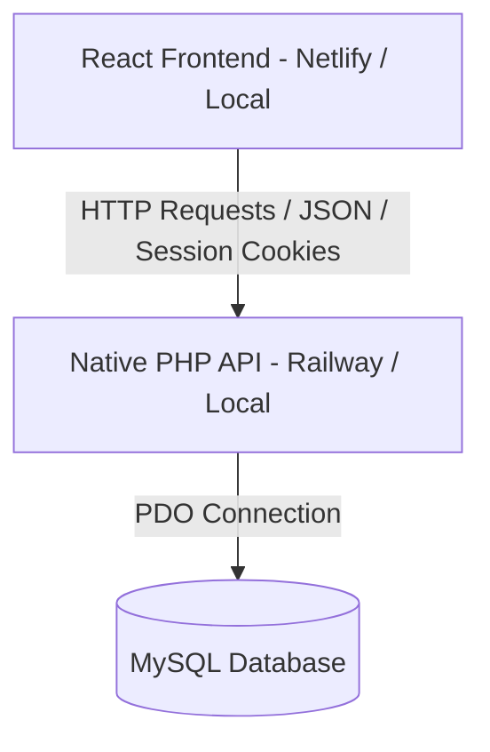
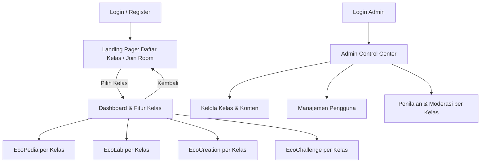
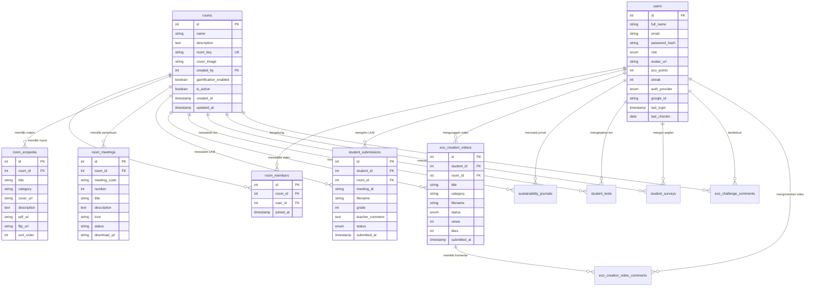

# Dokumen Spesifikasi Sistem (System Specification Document)
## **GAS Website — Green Action Students**
*Dari Pengetahuan ke Aksi Berkelanjutan (From Knowledge to Sustainable Action)*

Dokumen ini berisi penjelasan spesifikasi teknis lengkap dari platform **GAS Website**, sebuah platform edukasi keberlanjutan lingkungan yang dirancang untuk murid dan guru. Dokumen ini ditujukan kepada pengembang, pengajar, maupun administrator sistem untuk memahami arsitektur, skema basis data, alur kerja sistem, fungsionalitas modul, serta antarmuka API yang tersedia.

---

## **Daftar Isi**
1. [Deskripsi Umum & Tujuan](#1-deskripsi-umum--tujuan)
2. [Arsitektur Sistem & Stack Teknologi](#2-arsitektur-sistem--stack-teknologi)
3. [Spesifikasi Basis Data (Database Schema)](#3-spesifikasi-basis-data-database-schema)
4. [Spesifikasi Fungsional Modul (Murid)](#4-spesifikasi-fungsional-modul-murid)
5. [Spesifikasi API Endpoint (Backend PHP)](#5-spesifikasi-api-endpoint-backend-php)
6. [Struktur Direktori Proyek](#6-struktur-direktori-proyek)
7. [Panduan Instalasi & Deployment Lokal](#7-panduan-instalasi--deployment-lokal)

---

## **1. Deskripsi Umum & Tujuan**

**Green Action Students (GAS) Website** adalah aplikasi web interaktif yang dikembangkan untuk memfasilitasi pembelajaran keberlanjutan lingkungan secara kolaboratif melalui **Sistem Ruang Kelas (Multi-Room Learning Architecture)**. Fokus utama platform ini adalah memandu murid dalam proyek pembuatan **Ekoenzim** (fermentasi limbah kulit buah organik) serta penerapan **Kimia Hijau (Green Chemistry)** dalam lingkungan kelas terkelola.

Platform ini mengintegrasikan:
*   **Sistem Kelas (Multi-Room)**: Admin/guru membuat ruang kelas dengan kunci unik (Custom Room Key). Murid dapat bergabung ke banyak kelas sekaligus dan mengakses konten yang terisolasi per kelas.
*   **Pembelajaran Mandiri (EcoPedia)**: Membaca materi digital dan buku modul interaktif FlipHTML5 yang dikonfigurasi per kelas.
*   **Lembar Kerja Murid (EcoLab)**: Mengunduh worksheet LKM per pertemuan, memantau kemajuan, dan mengunggah laporan praktikum bertahap per kelas.
*   **Kolaborasi Kreatif (EcoCreation)**: Galeri video karya inovasi sains lingkungan yang diunggah dan dimoderasi per kelas.
*   **Evaluasi Pembelajaran (EcoChallenge)**: Mengerjakan pre/post-test evaluasi kasus dan angket respon pembelajaran dengan penilaian guru per kelas.
*   **Gamifikasi Terintegrasi (Opsional per Kelas)**: Admin dapat mengaktifkan sistem Eco-Points, Streak harian, dan Leaderboard kelas.

---

## **2. Arsitektur Sistem & Stack Teknologi**

Platform GAS menggunakan arsitektur **decoupled** (terpisah) antara antarmuka pengguna (Frontend SPA) dengan server logika data (Backend REST API).



### **A. Alur Navigasi & State Machine Aplikasi**


### **A. Stack Teknologi Frontend**
*   **Core**: React 19 (TypeScript) & Vite.
*   **Desain & Styling**: Tailwind CSS v4, Montserrat (Heading), Inter (Body).
*   **Ikonografi & Visual**: Lucide React Icons.
*   **Animasi UI**: Motion (Framer Motion) untuk transisi halaman yang mulus.
*   **Otentikasi & Sesi**: React Context (`AuthContext`) terintegrasi dengan cookies & backend PHP session.
*   **Deployment**: Dihosting di **Netlify** dengan file konfigurasi `netlify.toml` untuk rewrite rute SPA.

### **B. Stack Teknologi Backend**
*   **Bahasa Pemrograman**: Native PHP 8.2 (Object-Oriented & PDO).
*   **Keamanan Sesi**: Cookie berbasis `HttpOnly`, `Secure`, dan `SameSite=None` untuk mendukung pertukaran sesi lintas domain (cross-origin).
*   **Pengiriman Email**: PHPMailer untuk layanan pengiriman OTP lupa sandi.
*   **Otentikasi Google**: Integrasi Google Client Library untuk sistem Sign-in Google.
*   **Deployment**: Menggunakan Docker container (`Dockerfile`) dideploy di **Railway**, berjalan di PHP CLI built-in server dengan konfigurasi upload file hingga 100MB.

### **C. Basis Data (Database)**
*   **Sistem Manajemen**: MySQL / MariaDB.
*   **Koneksi**: PDO MySQL dengan mode persistent connection.

---
## **3. Spesifikasi Basis Data (Database Schema)**

Hubungan antar tabel dalam basis data `gas_website` dirancang menggunakan skema relasional terindeks untuk mendukung arsitektur multi-room (sistem kelas terisolasi).

### **Diagram Hubungan Entitas (Entity Relationship Diagram)**



### **Detail Struktur Tabel**

#### **1. Tabel `users`**
Menyimpan akun pengguna (murid, guru, dan admin).
| Field | Tipe Data | Nullable | Default | Keterangan |
| :--- | :--- | :--- | :--- | :--- |
| `id` | INT | No | *Auto-Increment* | Primary Key |
| `full_name` | VARCHAR(100) | No | | Nama lengkap pengguna |
| `email` | VARCHAR(150) | No | | Email unik pengguna |
| `password_hash` | VARCHAR(255) | Yes | NULL | Hash password (kosong jika login Google) |
| `role` | ENUM('student', 'teacher', 'admin') | No | 'student' | Hak akses sistem |
| `avatar_url` | VARCHAR(500) | Yes | NULL | URL foto profil pengguna |
| `eco_points` | INT | No | 0 | Skor gamifikasi lingkungan |
| `streak` | INT | No | 0 | Jumlah check-in berturut-turut |
| `auth_provider` | ENUM('local', 'google') | No | 'local' | Metode otentikasi akun |
| `google_id` | VARCHAR(255) | Yes | NULL | ID unik Google OAuth |
| `last_login` | TIMESTAMP | Yes | NULL | Waktu login terakhir |
| `last_checkin` | DATE | Yes | NULL | Tanggal check-in terakhir (streak) |
| `created_at` | TIMESTAMP | No | CURRENT_TIMESTAMP | Waktu pendaftaran akun |
| `updated_at` | TIMESTAMP | No | CURRENT_TIMESTAMP | Diperbarui otomatis saat baris dimodifikasi |

#### **2. Tabel `rooms` (Kelas)**
Menyimpan data entitas ruang kelas yang dibuat oleh administrator/guru.
| Field | Tipe Data | Nullable | Default | Keterangan |
| :--- | :--- | :--- | :--- | :--- |
| `id` | INT | No | *Auto-Increment* | Primary Key |
| `name` | VARCHAR(200) | No | | Nama ruang kelas (contoh: *Kimia Hijau X-A*) |
| `description` | TEXT | Yes | NULL | Penjelasan/silabus kelas |
| `room_key` | VARCHAR(50) | No | | Kunci masuk kelas unik (contoh: *GAS-KIMIA1*) |
| `cover_image` | VARCHAR(500) | Yes | NULL | URL gambar sampul kelas |
| `created_by` | INT | No | | Foreign Key -> `users.id` pembuat kelas |
| `gamification_enabled` | TINYINT(1) | No | 0 | 1 = Gamifikasi & Leaderboard aktif, 0 = Nonaktif |
| `is_active` | TINYINT(1) | No | 1 | Status kelas (1 = Aktif, 0 = Diarsipkan) |
| `created_at` | TIMESTAMP | No | CURRENT_TIMESTAMP | Waktu pembuatan kelas |
| `updated_at` | TIMESTAMP | No | CURRENT_TIMESTAMP | Diperbarui otomatis |

#### **3. Tabel `room_members`**
Menghubungkan murid dengan ruang kelas yang diikutinya (relasi many-to-many).
| Field | Tipe Data | Nullable | Default | Keterangan |
| :--- | :--- | :--- | :--- | :--- |
| `id` | INT | No | *Auto-Increment* | Primary Key |
| `room_id` | INT | No | | Foreign Key -> `rooms.id` (ON DELETE CASCADE) |
| `user_id` | INT | No | | Foreign Key -> `users.id` (ON DELETE CASCADE) |
| `joined_at` | TIMESTAMP | No | CURRENT_TIMESTAMP | Waktu murid bergabung ke kelas |

> [!NOTE]
> Memiliki UNIQUE KEY `(room_id, user_id)` untuk mencegah duplikasi pendaftaran murid pada kelas yang sama.

#### **4. Tabel `room_ecopedia`**
Koleksi buku bacaan modul digital yang dikonfigurasi per kelas.
| Field | Tipe Data | Nullable | Default | Keterangan |
| :--- | :--- | :--- | :--- | :--- |
| `id` | INT | No | *Auto-Increment* | Primary Key |
| `room_id` | INT | No | | Foreign Key -> `rooms.id` (ON DELETE CASCADE) |
| `title` | VARCHAR(300) | No | | Judul modul/buku |
| `category` | VARCHAR(100) | Yes | 'Umum' | Kategori bacaan |
| `cover_url` | VARCHAR(500) | Yes | '' | URL sampul buku |
| `description` | TEXT | Yes | NULL | Sinopsis materi |
| `content` | LONGTEXT | Yes | NULL | Rangkuman bacaan cepat |
| `pdf_url` | VARCHAR(500) | Yes | '#' | Tautan unduh PDF dokumen |
| `flip_url` | VARCHAR(500) | Yes | '' | Tautan pratinjau FlipHTML5 interaktif |
| `sort_order` | INT | No | 0 | Urutan tampilan buku |
| `created_at` | TIMESTAMP | No | CURRENT_TIMESTAMP | Waktu pembuatan |

#### **5. Tabel `room_meetings`**
Timeline tahapan praktikum EcoLab (pertemuan & berkas LKM) per kelas.
| Field | Tipe Data | Nullable | Default | Keterangan |
| :--- | :--- | :--- | :--- | :--- |
| `id` | INT | No | *Auto-Increment* | Primary Key |
| `room_id` | INT | No | | Foreign Key -> `rooms.id` (ON DELETE CASCADE) |
| `meeting_code` | VARCHAR(50) | No | 'm1' | Kode pertemuan (m1, m2, m3, dst.) |
| `number` | INT | No | 1 | Nomor urut pertemuan |
| `title` | VARCHAR(300) | No | | Judul sesi praktikum |
| `description` | TEXT | Yes | NULL | Instruksi praktikum |
| `icon` | VARCHAR(50) | Yes | 'science' | Ikon Lucide terkait |
| `status` | VARCHAR(50) | Yes | 'scheduled' | Status pertemuan (completed/ongoing/scheduled) |
| `embed_url` | VARCHAR(500) | Yes | '' | URL video/materi tersemat |
| `download_url` | VARCHAR(500) | Yes | '' | Tautan Google Drive / unduhan LKM resmi |
| `updated_at` | TIMESTAMP | No | CURRENT_TIMESTAMP | Diperbarui otomatis |

#### **6. Tabel `student_submissions`**
Menyimpan berkas tugas LKM yang dikumpulkan murid dalam konteks kelas tertentu.
| Field | Tipe Data | Nullable | Default | Keterangan |
| :--- | :--- | :--- | :--- | :--- |
| `id` | INT | No | *Auto-Increment* | Primary Key |
| `student_id` | INT | No | | Foreign Key -> `users.id` (ON DELETE CASCADE) |
| `room_id` | INT | Yes | NULL | Foreign Key -> `rooms.id` (Konteks kelas) |
| `meeting_id` | VARCHAR(10) | No | | Kode pertemuan (m1, m2, m3, dst.) |
| `filename` | VARCHAR(255) | No | | Nama file unik tersimpan di server |
| `original_name` | VARCHAR(255) | No | | Nama file asli unggahan murid |
| `grade` | TINYINT UNSIGNED | Yes | NULL | Nilai tugas (0 - 100) dari guru |
| `teacher_comment` | TEXT | Yes | NULL | Komentar evaluasi dari pengajar |
| `status` | ENUM('pending', 'graded') | No | 'pending' | Status peninjauan tugas |
| `submitted_at` | TIMESTAMP | No | CURRENT_TIMESTAMP | Waktu pengiriman tugas |
| `graded_at` | TIMESTAMP | Yes | NULL | Waktu pemberian nilai |

#### **7. Tabel `eco_creation_videos`**
Unggahan karya video inovasi sains murid dalam konteks kelas tertentu.
| Field | Tipe Data | Nullable | Default | Keterangan |
| :--- | :--- | :--- | :--- | :--- |
| `id` | INT | No | *Auto-Increment* | Primary Key |
| `student_id` | INT | No | | Foreign Key -> `users.id` (ON DELETE CASCADE) |
| `room_id` | INT | Yes | NULL | Foreign Key -> `rooms.id` (Konteks kelas) |
| `title` | VARCHAR(300) | No | | Judul video karya |
| `category` | VARCHAR(100) | No | 'Umum' | Kategori karya |
| `duration` | VARCHAR(10) | Yes | NULL | Durasi video (MM:SS) |
| `filename` | VARCHAR(255) | No | | Nama berkas file video |
| `original_name` | VARCHAR(255) | No | | Nama file asli |
| `status` | ENUM('pending', 'approved', 'rejected') | No | 'pending' | Status moderasi |
| `reject_reason` | VARCHAR(500) | Yes | NULL | Alasan penolakan (jika ada) |
| `views` | INT | No | 0 | Total tayangan |
| `likes` | INT | No | 0 | Total suka |
| `submitted_at` | TIMESTAMP | No | CURRENT_TIMESTAMP | Waktu unggah |
| `approved_at` | TIMESTAMP | Yes | NULL | Waktu persetujuan |

#### **8. Tabel `sustainability_journals`**
Catatan refleksi aksi nyata keberlanjutan mandiri murid.
| Field | Tipe Data | Nullable | Default | Keterangan |
| :--- | :--- | :--- | :--- | :--- |
| `id` | INT | No | *Auto-Increment* | Primary Key |
| `student_id` | INT | No | | Foreign Key -> `users.id` |
| `room_id` | INT | Yes | NULL | Foreign Key -> `rooms.id` |
| `entry_date` | DATE | No | | Tanggal pelaksanaan aksi |
| `title` | VARCHAR(255) | No | | Judul aksi ramah lingkungan |
| `action_type` | VARCHAR(100) | No | | Jenis aksi (daur ulang, hemat energi, dll.) |
| `description` | TEXT | No | | Deskripsi detail pelaksanaan |
| `impact_notes` | TEXT | Yes | NULL | Dampak terukur yang dihasilkan |
| `eco_points_earned` | INT | No | 15 | Poin yang diperoleh dari jurnal |
| `created_at` | TIMESTAMP | No | CURRENT_TIMESTAMP | Waktu penyimpanan |

#### **9. Tabel `student_tests` & `student_surveys`**
Menyimpan hasil pengerjaan Pre/Post Test dan Angket Respon Pembelajaran per murid per kelas.
*   `student_tests`: `id`, `student_id`, `room_id`, `test_type` ('pre' / 'post'), `answers` (JSON), `score`, `submitted_at`.
*   `student_surveys`: `id`, `student_id`, `room_id`, `survey_type`, `responses` (JSON), `submitted_at`.

#### **10. Tabel `password_resets`**
Menampung kode OTP untuk verifikasi atur ulang kata sandi (`email`, `otp_code`, `expires_at`, `used`).

---

## **4. Spesifikasi Fungsional Modul**

### **A. Modul Otentikasi & Pengaturan Pengguna**
*   **Registrasi & Login**: Otentikasi lokal (email & sandi) atau menggunakan Akun Google (OAuth 2.0).
*   **Lupa Sandi (OTP)**: Verifikasi OTP 6 digit via email PHPMailer untuk pemulihan akun.
*   **Profil Pengguna**: Penggantian nama, foto avatar kustom, perubahan sandi, atau penghapusan avatar.

### **B. Landing Page Kelas (`RoomListView`)**
*   **Daftar Kelas Terdaftar**: Menampilkan kartu seluruh kelas yang sedang diikuti oleh murid, lengkap dengan status gamifikasi, nama pengajar, dan deskripsi.
*   **Gabung Kelas Baru (Join Room)**: Input modal untuk memasukkan **Kunci Kelas (Room Key)** yang diberikan guru.
*   **Keluar dari Kelas (Leave Room)**: Opsi mandiri bagi murid untuk keluar dari kelas tertentu.
*   **Akses Kelas**: Mengklik kelas mengaktifkan sesi kelas terpilih dan mengarahkan murid ke Dashboard Ruang Kelas.

### **C. Dashboard Ruang Kelas (`DashboardView`)**
*   **Header Konteks Kelas**: Menampilkan nama kelas aktif, deskripsi, dan tombol navigasi kembali ke daftar kelas.
*   **Gamifikasi Terintegrasi (Kondisional)**: Jika gamifikasi aktif di kelas tersebut:
    *   Menampilkan Eco-Points murid & Streak harian.
    *   Presensi harian (*Daily Check-in*) berhadiah +20 Eco-Points.
    *   **Leaderboard Kelas**: Peringkat anggota di kelas tersebut secara *real-time*.
*   **Ringkasan Status Proyek**: Melacak persentase pengumpulan LKM dan video kreasi di kelas aktif.

### **D. EcoPedia Kelas (`EcoPediaView`)**
*   **Koleksi Bacaan Kelas**: Menampilkan materi digital yang secara spesifik dikonfigurasi untuk ruang kelas tersebut.
*   **FlipHTML5 Reader**: Pembaca interaktif flipbook terintegrasi langsung di dalam aplikasi web.
*   **Rangkuman Cepat & Unduh PDF**: Ringkasan poin penting dan tombol unduh dokumen modul resmi.

### **E. EcoLab Kelas (`EcoLabView`)**
*   **Timeline Pertemuan Dinamis**: Mengambil data sesi praktikum dari `room_meetings` kelas aktif.
*   **Unduh Panduan LKM**: Mengunduh lembar kerja resmi per pertemuan via tautan yang ditentukan pengajar.
*   **Unggah Laporan LKM**: Mengunggah berkas LKM (PDF/DOCX maks 10MB) terisolasi per kelas. Murid dapat melihat nilai dan catatan koreksi guru, atau menghapus berkas untuk revisi.
*   **Jurnal Keberlanjutan Mandiri (Sustainability Journal)**: Mencatat aksi nyata ramah lingkungan di lingkungan rumah/sekolah murid.

### **F. EcoCreation Kelas (`EcoCreationView`)**
*   **Galeri Video Inovasi Kelas**: Galeri video karya sains siswa khusus untuk kelas yang sedang dibuka.
*   **Unggah & Pratinjau Video**: Mengunggah berkas video (MP4/MOV/AVI) dengan deteksi durasi otomatis.
*   **Pemutar Video & Interaksi**: Streaming video langsung di browser, pemberian like, dan diskusi komentar video.
*   **Manajemen Video Sendiri**: Siswa dapat mengedit judul atau menghapus video karyanya.

### **G. EcoChallenge Kelas (`EcoChallengeView`)**
*   **Pre-Test & Post-Test**: Evaluasi pemahaman konsep kimia hijau dan ekoenzim secara digital per kelas dengan penilaian otomatis.
*   **Angket Respon Pembelajaran**: Kuesioner evaluasi efektivitas pembelajaran berbasis Likert scale terisolasi per kelas.
*   **Forum Diskusi Kelas**: Ruang tanya jawab dan diskusi antar sesama anggota ruang kelas.

### **H. Panel Administrator (Admin Control Center)**
*   **Manajemen Ruang Kelas (`AdminRoomsView`)**:
    *   Membuat, mengedit, dan menghapus ruang kelas serta menentukan Room Key unik.
    *   Mengaktifkan atau menonaktifkan fitur gamifikasi per kelas.
    *   **Kelola Anggota**: Memeriksa daftar murid yang bergabung dalam kelas dan menghapus murid jika diperlukan.
    *   **Kelola Konten Kelas**: Modal khusus dengan sub-tab **EcoPedia** (tambah/edit/hapus buku kelas) dan **Pertemuan EcoLab** (atur timeline, link unduh LKM, dan status pertemuan per kelas).
*   **Penilaian & Moderasi Per Ruang Kelas**:
    *   `AdminEcolabView`: Filter dropdown per kelas untuk memeriksa, mengunduh, dan memberikan nilai serta catatan LKM dan jurnal keberlanjutan.
    *   `AdminEcocreationView`: Filter dropdown per kelas untuk memoderasi (setujui/tolak) karya video kreasi siswa.
    *   `AdminEcochallengeView`: Filter dropdown per kelas untuk melihat hasil rekapitulasi Pre/Post Test dan Angket Pembelajaran murid.
*   **Manajemen Pengguna (`AdminUsersView`)**: Manajemen seluruh akun terdaftar pada sistem GAS.

---

## **5. Spesifikasi API Endpoint (Backend PHP)**

Semua endpoint API terletak di direktori `/api/` dan mengembalikan respons berformat JSON terstruktur (`{ "success": boolean, "data": ..., "message": ... }`).

### **A. API Otentikasi & Pengguna**
*   `POST /api/register.php`: Mendaftarkan akun murid (`full_name`, `email`, `password`).
*   `POST /api/login.php`: Validasi kredensial pengguna lokal.
*   `POST /api/google-auth.php`: Login via token Google OAuth.
*   `GET /api/session.php`: Memeriksa sesi login aktif pengguna saat ini.
*   `POST /api/logout.php`: Mengakhiri sesi pengguna.
*   `POST /api/forgot-password.php`: Mengirim kode OTP ke email.
*   `POST /api/reset-password.php`: Mereset kata sandi dengan verifikasi OTP.
*   `POST /api/update-profile.php`: Memperbarui profil, avatar, atau password.
*   `POST /api/checkin.php`: Klaim presensi harian untuk menambah poin & streak.

### **B. API Ruang Kelas Murid (`/api/rooms.php`)**
*   `GET /api/rooms.php?action=my_rooms`: Mengambil daftar seluruh kelas yang diikuti pengguna saat ini beserta data ringkasan kelas.
*   `POST /api/rooms.php?action=join`: Bergabung ke kelas baru (`code`: kunci kelas).
*   `POST /api/rooms.php?action=leave`: Keluar dari kelas (`room_id`: ID kelas).
*   `GET /api/rooms.php?action=detail&id={id}`: Mengambil detail lengkap kelas tertentu.
*   `GET /api/rooms.php?action=leaderboard&room_id={id}`: Mengambil leaderboard murid khusus di dalam kelas tersebut.

### **C. API Konten Ruang Kelas (`/api/room-content.php`)**
*   `GET /api/room-content.php?room_id={id}&type=ecopedia`: Mengambil materi modul buku EcoPedia kelas.
*   `GET /api/room-content.php?room_id={id}&type=meetings`: Mengambil daftar timeline sesi pertemuan EcoLab kelas.
*   `POST /api/room-content.php`: Menambahkan modul atau sesi pertemuan baru ke kelas (Khusus Admin).
*   `PUT /api/room-content.php`: Memperbarui data modul atau pertemuan kelas (Khusus Admin).
*   `DELETE /api/room-content.php?id={id}&type={ecopedia|meetings}`: Menghapus modul atau sesi pertemuan (Khusus Admin).

### **D. API Administrasi Kelas & Anggota**
*   `GET /api/admin/rooms.php`: Mengambil semua daftar kelas beserta statistik jumlah anggota.
*   `POST /api/admin/rooms.php`: Membuat kelas baru (`name`, `description`, `room_key`, `gamification_enabled`).
*   `PUT /api/admin/rooms.php`: Mengubah data kelas (`id`, `name`, `description`, `room_key`, `gamification_enabled`, `is_active`).
*   `DELETE /api/admin/rooms.php?id={id}`: Menghapus kelas beserta relasi data di dalamnya.
*   `GET /api/admin/room-members.php?room_id={id}`: Mengambil daftar seluruh murid dalam kelas tertentu.
*   `DELETE /api/admin/room-members.php?room_id={id}&user_id={id}`: Mengeluarkan murid tertentu dari kelas.

### **E. API EcoLab (LKM & Jurnal)**
*   `GET /api/get-submissions.php?room_id={id}`: Mengambil berkas LKM yang dikumpulkan murid pada kelas tertentu (untuk murid) atau semua pengumpulan di kelas (untuk admin).
*   `POST /api/upload-submission.php`: Mengunggah berkas LKM per pertemuan (`room_id`, `meeting_id`, `lkm_file`).
*   `POST /api/delete-submission.php`: Menghapus berkas LKM yang telah diunggah.
*   `GET /api/sustainability-journal.php?room_id={id}`: Mengambil catatan jurnal keberlanjutan murid pada kelas terpilih.
*   `POST /api/sustainability-journal.php`: Menyimpan catatan aksi keberlanjutan baru (`room_id`, `entry_date`, `title`, `action_type`, `description`, `impact_notes`).

### **F. API EcoCreation (Karya Video)**
*   `GET /api/get-videos.php?room_id={id}`: Mengambil daftar video terverifikasi pada kelas terpilih (atau semua status jika dipanggil admin).
*   `POST /api/upload-video.php`: Mengunggah video inovasi baru (`room_id`, `title`, `category`, `duration`, `video_file`).
*   `POST /api/edit-video.php`: Mengubah judul atau mengganti file video.
*   `POST /api/delete-video.php`: Menghapus video karya.
*   `POST /api/like-video.php`: Menambah like pada video.
*   `GET /api/stream-video.php`: Layanan streaming video MP4 via HTTP range request.

### **G. API EcoChallenge (Evaluasi & Diskusi)**
*   `GET /api/student-test.php?room_id={id}`: Mengambil riwayat pre/post test murid di kelas.
*   `POST /api/student-test.php`: Mengirim lembar jawaban test (`room_id`, `test_type`, `answers`, `score`).
*   `GET /api/student-survey.php?room_id={id}`: Mengambil data respons angket murid di kelas.
*   `POST /api/student-survey.php`: Mengirim respons angket pembelajaran (`room_id`, `survey_type`, `responses`).
*   `GET /api/get-comments.php?room_id={id}`: Mengambil forum diskusi kelas.
*   `POST /api/add-comment.php`: Mengirim komentar diskusi baru (`room_id`, `content`).

---

## **6. Struktur Direktori Proyek**

Berikut adalah struktur folder utama dari proyek **GAS Website**:

```text
GAS Website/
│
├── api/                       # REST API Backend (PHP Native)
│   ├── config.php             # DB PDO, CORS, Session, & Auto-Migration
│   ├── session.php            # Validasi sesi aktif
│   ├── login.php / register.php # Otentikasi lokal
│   ├── google-auth.php        # Google OAuth Sign-in
│   ├── rooms.php              # API Kelas Murid (my_rooms, join, leave, leaderboard)
│   ├── room-content.php       # API Konten Kelas (EcoPedia & Meetings CRUD)
│   ├── ecolab.php             # Data pertemuan EcoLab
│   ├── get-submissions.php    # Ambil LKM tersimpan (scoped by room_id)
│   ├── upload-submission.php  # Unggah berkas LKM (scoped by room_id)
│   ├── delete-submission.php  # Hapus berkas LKM
│   ├── sustainability-journal.php # API Jurnal Keberlanjutan Mandiri
│   ├── get-videos.php         # Galeri video karya (scoped by room_id)
│   ├── upload-video.php       # Unggah karya video (scoped by room_id)
│   ├── stream-video.php       # Layanan streaming berkas video
│   ├── student-test.php       # Pengerjaan & riwayat Pre/Post Test
│   ├── student-survey.php     # Respons Angket Pembelajaran
│   ├── checkin.php            # Daily Check-in & Eco-Points
│   ├── update-profile.php     # Pembaruan profil & avatar
│   └── admin/                 # Endpoint Khusus Panel Administrator
│       ├── rooms.php          # CRUD Ruang Kelas
│       ├── room-members.php   # Manajemen Murid per Ruang Kelas
│       ├── submissions.php    # Penilaian LKM
│       ├── videos.php         # Moderasi Video
│       └── users.php          # Manajemen Akun Pengguna
│
├── database/                  # Skrip & Migrasi Basis Data
│   ├── schema.sql             # Skema tabel dasar lengkap
│   ├── migrate_rooms.sql      # Skrip migrasi DDL sistem kelas multi-room
│   └── gas_website.sql        # Backup basis data
│
├── public/                    # Aset statis frontend (Gambar, Favicon, dll.)
│
├── src/                       # Source Code Frontend (React 19 + TypeScript)
│   ├── assets/                # Gambar, logo, & styling global
│   ├── components/            # Komponen Tampilan SPA
│   │   ├── auth/              # Form Login, Register, & Forgot Password
│   │   ├── admin/             # Tampilan Panel Administrator
│   │   │   ├── AdminRoomsView.tsx       # Kelola Kelas, Anggota, & Konten
│   │   │   ├── AdminEcolabView.tsx      # Penilaian LKM dengan Filter Kelas
│   │   │   ├── AdminEcocreationView.tsx  # Moderasi Video dengan Filter Kelas
│   │   │   ├── AdminEcochallengeView.tsx# Evaluasi Test/Angket dengan Filter Kelas
│   │   │   └── AdminUsersView.tsx       # Kelola Akun Pengguna
│   │   ├── RoomListView.tsx   # Landing Page Daftar Kelas & Gabung Kelas
│   │   ├── DashboardView.tsx  # Dashboard Utama dalam Ruang Kelas
│   │   ├── EcoPediaView.tsx   # Modul Flipbook & Bacaan per Kelas
│   │   ├── EcoLabView.tsx     # Timeline Praktikum & LKM per Kelas
│   │   ├── EcoCreationView.tsx# Galeri Video Siswa per Kelas
│   │   ├── EcoChallengeView.tsx# Evaluasi Test & Diskusi per Kelas
│   │   ├── SustainabilityJournalModal.tsx # Modal Jurnal Mandiri
│   │   └── Header.tsx / Sidebar.tsx # Navigasi & Breadcrumb Kelas
│   ├── context/               # Global State (AuthContext)
│   ├── services/              # API Client (roomService, videoService, submissionService, etc.)
│   ├── types.ts               # Model Type TypeScript (Room, Member, Tab, dll.)
│   ├── App.tsx                # State Machine Utama (Auth -> Rooms -> Dashboard)
│   └── main.tsx               # React Entrypoint
│
├── index.html                 # Dokumen HTML Root
├── package.json               # Konfigurasi Dependensi & Script
├── vite.config.ts             # Bundler Vite
├── netlify.toml               # Rewrite Rules Deployment SPA
└── Dockerfile                 # Konfigurasi Container Backend (Railway)
```

---

## **7. Panduan Instalasi & Deployment Lokal**

### **A. Kebutuhan Sistem**
1.  **Node.js** (Versi 18 atau lebih baru)
2.  **PHP** (Versi 8.1 / 8.2) dengan ekstensi PDO MySQL aktif
3.  **MySQL / MariaDB** (melalui Laragon / XAMPP / Docker)

### **B. Langkah Instalasi**

#### **1. Setup Database**
*   Buka MySQL client (PhpMyAdmin / DBeaver / Navicat / HeidiSQL).
*   Buat database baru dengan nama `gas_website`.
*   Import file database `database/schema.sql`.
*   *(Otomatis)* Skrip `api/config.php` telah dilengkapi fitur **auto-migration** yang secara otomatis akan mengeksekusi penambahan tabel-tabel multi-room (`rooms`, `room_members`, `room_ecopedia`, `room_meetings`) serta menambahkan kolom `room_id` pada tabel data lama jika belum ada.

#### **2. Setup API Backend (PHP)**
*   Pastikan direktori proyek dapat diakses oleh web server lokal (Apache / Nginx / PHP CLI).
*   Buka file `api/config.php` dan pastikan konfigurasi basis data lokal Anda sesuai:
    ```php
    $db_host = 'localhost';
    $db_name = 'gas_website';
    $db_user = 'root';
    $db_pass = '';
    ```
*   Pastikan folder `api/uploads/` memiliki izin tulis (*write permission*) untuk menyimpan berkas LKM, avatar, dan video.

#### **3. Setup Frontend (React)**
*   Buka terminal di root direktori proyek `gas-website-main`.
*   Pasang seluruh pustaka dependensi:
    ```bash
    npm install
    ```
*   Pastikan konfigurasi URL backend di file `.env.local` atau `src/config.ts` sesuai dengan URL server PHP Anda:
    ```env
    VITE_API_BASE_URL=http://localhost:8000/api
    ```
*   Jalankan server pengembangan:
    ```bash
    npm run dev
    ```
*   Buka browser dan buka `http://localhost:3000`.

---

> Dokumen spesifikasi sistem ini diperbarui pada **Oktober 2026** mencakup arsitektur Sistem Kelas (Multi-Room), manajemen konten kelas independen, sistem penilaian terisolasi per kelas, serta penghapusan modul legacy. Hubungi Administrator GAS Website jika terdapat penyesuaian fungsional sistem di masa mendatang.

