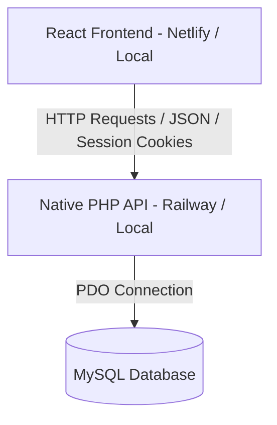
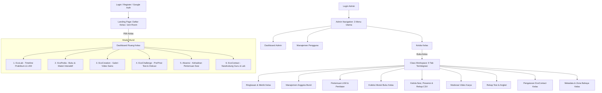

# Dokumen Spesifikasi Sistem (System Specification Document)
## **GAS Website — Green Action Students**
*Dari Pengetahuan ke Aksi Berkelanjutan (From Knowledge to Sustainable Action)*

Dokumen ini berisi penjelasan spesifikasi teknis lengkap dari platform **GAS Website**, sebuah platform edukasi keberlanjutan lingkungan yang dirancang untuk murid dan guru. Dokumen ini ditujukan kepada pengembang, pengajar, maupun administrator sistem untuk memahami arsitektur, skema basis data, alur kerja sistem, fungsionalitas modul, serta antarmuka API yang tersedia.

---

## **Daftar Isi**
1. [Deskripsi Umum & Tujuan](#1-deskripsi-umum--tujuan)
2. [Arsitektur Sistem & Stack Teknologi](#2-arsitektur-sistem--stack-teknologi)
3. [Spesifikasi Basis Data (Database Schema)](#3-spesifikasi-basis-data-database-schema)
4. [Spesifikasi Fungsional Modul (Murid)](#4-spesifikasi-fungsional-modul-murid)
5. [Spesifikasi Fungsional Modul (Admin & Guru)](#5-spesifikasi-fungsional-modul-admin--guru)
6. [Spesifikasi API Endpoint (Backend PHP)](#6-spesifikasi-api-endpoint-backend-php)
7. [Struktur Direktori Proyek](#7-struktur-direktori-proyek)
8. [Panduan Instalasi & Deployment](#8-panduan-instalasi--deployment)

---

## **1. Deskripsi Umum & Tujuan**

**Green Action Students (GAS) Website** adalah aplikasi web interaktif yang dikembangkan untuk memfasilitasi pembelajaran keberlanjutan lingkungan secara kolaboratif melalui **Sistem Ruang Kelas (Multi-Room Learning Architecture)**. Fokus utama platform ini adalah memandu murid dalam proyek pembuatan **Ekoenzim** (fermentasi limbah kulit buah organik) serta penerapan **Kimia Hijau (Green Chemistry)** dalam lingkungan kelas terkelola.

Platform ini mengintegrasikan:
*   **Sistem Kelas (Multi-Room)**: Admin/guru membuat ruang kelas dengan kunci unik (Custom Room Key). Murid dapat bergabung ke banyak kelas sekaligus dan mengakses konten yang terisolasi per kelas.
*   **Lembar Kerja Praktikum (EcoLab)**: Timeline tahapan praktikum per pertemuan, unduhan lembar kerja (LKM), pengumpulan berkas tugas siswa, evaluasi nilai & catatan guru, serta pencatatan Jurnal Keberlanjutan Mandiri. Ditempatkan di atas EcoPedia untuk mencerminkan alur berbasis aktivitas praktikum.
*   **Modul Pembelajaran Digital (EcoPedia)**: Membaca materi digital dan buku modul interaktif FlipHTML5 yang dikonfigurasi secara mandiri per kelas.
*   **Galeri Kreasi Video (EcoCreation)**: Galeri video karya inovasi sains lingkungan yang diunggah dan dimoderasi per kelas dengan fitur interaksi like & komentar.
*   **Evaluasi Pembelajaran (EcoChallenge)**: Mengerjakan pre/post-test evaluasi kasus dan angket respon pembelajaran dengan penilaian guru serta forum diskusi kelas.
*   **Sistem Presensi Kelas (Absensi)**: Pencatatan kehadiran murid per sesi/pertemuan kelas dengan kode akses opsional, batas waktu sesi, koreksi status kehadiran (Hadir, Sakit, Izin, Alpa) oleh guru, rekap matriks, dan ekspor CSV.
*   **Kontak Bantuan & Pengajar (EcoContact)**: Direktori per-kelas untuk menampilkan narahubung guru pengampu, asisten laboratorium, dan koordinator lingkungan dengan tautan langsung WhatsApp dan Email.
*   **Bebas Distraksi Gamifikasi**: Fitur gamifikasi (seperti streak, eco_points, leaderboard, dan daily check-in) telah dinonaktifkan/dihapus agar fokus murid dan pengajar sepenuhnya terarah pada pencapaian akademik dan proyek lingkungan nyata.

---

## **2. Arsitektur Sistem & Stack Teknologi**

Platform GAS menggunakan arsitektur **decoupled** antara antarmuka pengguna (Frontend SPA) dengan server logika data (Backend REST API).



### **A. Alur Navigasi & State Machine Aplikasi**


### **B. Stack Teknologi Frontend**
*   **Core**: React 19 (TypeScript) & Vite.
*   **Desain & Styling**: Tailwind CSS, Vanilla CSS dengan palet tematik (Emerald/Amber untuk Murid, Slate/Cyan untuk Admin Workspace), tipografi Montserrat (Display) & Inter (Sans).
*   **Ikonografi**: Lucide React Icons.
*   **Animasi UI**: Motion (Framer Motion) untuk transisi halus dan micro-interactions.
*   **Otentikasi & Sesi**: React Context (`AuthContext`) terintegrasi dengan cookies & backend PHP session.
*   **Deployment**: Dihosting di **Netlify** dengan file konfigurasi `netlify.toml` untuk rewrite rute SPA.

### **C. Stack Teknologi Backend**
*   **Bahasa Pemrograman**: Native PHP 8.2 (Object-Oriented & PDO).
*   **Keamanan Sesi**: Cookie berbasis `HttpOnly`, `Secure`, dan `SameSite=None` untuk mendukung pertukaran sesi lintas domain (cross-origin).
*   **Pengiriman Email**: PHPMailer untuk layanan pengiriman OTP lupa sandi.
*   **Otentikasi Google**: Integrasi Google Client Library untuk sistem Sign-in Google.
*   **Auto-Migration**: Mekanisme auto-migration otomatis di `api/config.php` yang mendeteksi dan membuat tabel/kolom baru saat server pertama kali dijalankan tanpa merusak data lama.
*   **Deployment**: Menggunakan Docker container (`Dockerfile`) dideploy di **Railway**, berjalan di PHP CLI built-in server dengan konfigurasi upload file hingga 100MB.

### **D. Basis Data (Database)**
*   **Sistem Manajemen**: MySQL / MariaDB (versi 8.0+).
*   **Koneksi**: PDO MySQL dengan mode persistent connection dan charset `utf8mb4`.

---

## **3. Spesifikasi Basis Data (Database Schema)**

### **Diagram Hubungan Entitas (Entity Relationship Diagram)**

```mermaid
erDiagram
    users ||--o{ room_members : "bergabung"
    rooms ||--o{ room_members : "memiliki murid"
    rooms ||--o{ room_ecopedia : "memiliki buku materi"
    rooms ||--o{ room_meetings : "memiliki pertemuan praktikum"
    rooms ||--o{ room_attendance_sessions : "memiliki sesi presensi"
    rooms ||--o{ room_contacts : "memiliki narahubung"
    
    room_attendance_sessions ||--o{ room_attendance_records : "mencatat kehadiran"
    users ||--o{ room_attendance_records : "mengisi presensi"

    users ||--o{ student_submissions : "mengirim LKM"
    rooms ||--o{ student_submissions : "mewadahi LKM"
    
    users ||--o{ eco_creation_videos : "mengunggah video"
    rooms ||--o{ eco_creation_videos : "mewadahi video"
    
    users ||--o{ sustainability_journals : "mencatat jurnal"
    rooms ||--o{ sustainability_journals : "mewadahi jurnal"

    users ||--o{ student_tests : "mengerjakan tes"
    rooms ||--o{ student_tests : "mewadahi tes"

    users ||--o{ student_surveys : "mengisi angket"
    rooms ||--o{ student_surveys : "mewadahi angket"

    users ||--o{ eco_challenge_comments : "berdiskusi"
    rooms ||--o{ eco_challenge_comments : "forum kelas"
```



### **Detail Struktur Tabel Baru & Utama**

#### **1. Tabel `rooms` (Kelas)**
Menyimpan data entitas ruang kelas yang dibuat oleh administrator/guru.
| Field | Tipe Data | Nullable | Default | Keterangan |
| :--- | :--- | :--- | :--- | :--- |
| `id` | INT | No | *Auto-Increment* | Primary Key |
| `name` | VARCHAR(200) | No | | Nama ruang kelas |
| `description` | TEXT | Yes | NULL | Penjelasan/silabus kelas |
| `room_key` | VARCHAR(50) | No | | Kunci masuk kelas unik (contoh: *GAS-KIMIA1*) |
| `cover_image` | VARCHAR(500) | Yes | NULL | URL gambar sampul kelas |
| `created_by` | INT | No | | Foreign Key -> `users.id` pembuat kelas |
| `is_active` | TINYINT(1) | No | 1 | Status kelas (1 = Aktif, 0 = Nonaktif) |
| `created_at` | TIMESTAMP | No | CURRENT_TIMESTAMP | Waktu pembuatan kelas |
| `updated_at` | TIMESTAMP | No | CURRENT_TIMESTAMP | Diperbarui otomatis |

#### **2. Tabel `room_attendance_sessions` (Sesi Presensi Kelas)**
Menyimpan sesi pertemuan presensi yang dibuka guru untuk kelas tertentu.
| Field | Tipe Data | Nullable | Default | Keterangan |
| :--- | :--- | :--- | :--- | :--- |
| `id` | INT | No | *Auto-Increment* | Primary Key |
| `room_id` | INT | No | | Foreign Key -> `rooms.id` (ON DELETE CASCADE) |
| `title` | VARCHAR(255) | No | | Judul sesi (contoh: *Pertemuan 1: Pengenalan Ekoenzim*) |
| `session_date` | DATE | No | | Tanggal pelaksanaan |
| `start_time` | TIME | Yes | NULL | Jam mulai presensi |
| `end_time` | TIME | Yes | NULL | Jam batas presensi |
| `access_code` | VARCHAR(32) | Yes | NULL | Kode akses/token unik presensi murid |
| `is_open` | TINYINT(1) | No | 1 | Status buka/tutup presensi (1 = Buka, 0 = Tutup) |
| `created_by` | INT | Yes | NULL | ID pengajar pembuat sesi |
| `created_at` | TIMESTAMP | No | CURRENT_TIMESTAMP | Waktu pembuatan |

#### **3. Tabel `room_attendance_records` (Catatan Presensi Murid)**
Menyimpan riwayat kehadiran individual murid per sesi presensi.
| Field | Tipe Data | Nullable | Default | Keterangan |
| :--- | :--- | :--- | :--- | :--- |
| `id` | INT | No | *Auto-Increment* | Primary Key |
| `session_id` | INT | No | | Foreign Key -> `room_attendance_sessions.id` |
| `user_id` | INT | No | | Foreign Key -> `users.id` |
| `status` | ENUM | No | 'hadir' | Status: `'hadir'`, `'izin'`, `'sakit'`, `'alpa'` |
| `notes` | TEXT | Yes | NULL | Keterangan/alasan ketidakhadiran |
| `checked_in_at` | TIMESTAMP | No | CURRENT_TIMESTAMP | Waktu perekaman presensi |
| `checked_by` | INT | Yes | NULL | NULL jika murid sendiri, ID guru jika dikoreksi |

#### **4. Tabel `room_contacts` (EcoContact Per Kelas)**
Menyimpan direktori kontak narahubung/dosen/guru pendamping kelas.
| Field | Tipe Data | Nullable | Default | Keterangan |
| :--- | :--- | :--- | :--- | :--- |
| `id` | INT | No | *Auto-Increment* | Primary Key |
| `room_id` | INT | No | | Foreign Key -> `rooms.id` (ON DELETE CASCADE) |
| `name` | VARCHAR(150) | No | | Nama lengkap narahubung |
| `role_title` | VARCHAR(150) | No | | Jabatan (contoh: *Guru Kimia*, *Asisten Lab*) |
| `phone` | VARCHAR(50) | Yes | NULL | Nomor kontak WhatsApp (+62...) |
| `email` | VARCHAR(150) | Yes | NULL | Alamat email resmi |
| `office_hours` | VARCHAR(200) | Yes | NULL | Jadwal konsultasi (contoh: *Senin-Jumat 08:00 - 15:00*) |
| `avatar_url` | VARCHAR(500) | Yes | NULL | Foto profil narahubung |
| `sort_order` | INT | No | 0 | Urutan tampilan kartu kontak |
| `created_at` | TIMESTAMP | No | CURRENT_TIMESTAMP | Waktu penambahan |

---

## **4. Spesifikasi Fungsional Modul (Murid)**

Navigasi bilah samping (Sidebar) murid disusun secara ergonomis dalam 7 modul:

1. **Dashboard Ruang Kelas (`DashboardView`)**:
   - Status ringkasan kelas aktif, sambutan personal, dan informasi anggota.
   - Banner status presensi sesi hari ini (apakah ada sesi aktif yang memerlukan check-in).
   - Indikator kemajuan praktikum LKM EcoLab dan jalan pintas modul belajar.
2. **EcoLab (`EcoLabView`)**:
   - **Timeline Praktikum**: Mengunduh berkas petunjuk LKM per nomor pertemuan.
   - **Pengumpulan Berkas**: Mengunggah berkas LKM (PDF/DOCX/ZIP maks 10MB) terisolasi per kelas.
   - **Umpan Balik Guru**: Memantau status peninjauan, nilai angka (0-100), dan catatan koreksi guru.
   - **Jurnal Keberlanjutan Mandiri**: Mencatat aksi nyata penyelamatan lingkungan dan fermentasi harian.
3. **EcoPedia (`EcoPediaView`)**:
   - Akses koleksi modul bacaan dan buku panduan digital per kelas.
   - Integrasi FlipHTML5 interaktif untuk membaca seperti buku fisik.
   - Tombol unduhan dokumen PDF pendukung.
4. **EcoCreation (`EcoCreationView`)**:
   - Galeri video inovasi sains yang diunggah oleh sesama rekan kelas.
   - Unggah karya video inovasi (MP4/MOV/AVI) dengan deteksi durasi otomatis.
   - Pemutar video di browser, tombol suka (like), dan kolom komentar diskusi video.
5. **EcoChallenge (`EcoChallengeView`)**:
   - Evaluasi Pre-Test dan Post-Test berbasis studi kasus kimia hijau.
   - Pengisian Angket Respon Pembelajaran berbasis skala Likert.
   - Forum diskusi tanya-jawab antarmurid dalam kelas.
6. **Absensi (`AttendanceView`)**:
   - Kartu metrik kehadiran pribadi: Total Hadir, Izin, Sakit, Alpa, dan persentase kehadiran akumulatif.
   - Formulir check-in cepat untuk sesi yang sedang dibuka pengajar (dengan opsi input kode token kelas).
   - Riwayat kehadiran per pertemuan lengkap dengan catatan dan stempel waktu.
7. **EcoContact (`EcoContactView`)**:
   - Kartu kontak pendamping kelas (Guru Kimia, Asisten Lab, Admin Teknis).
   - Tombol langsung untuk memulai obrolan WhatsApp atau mengirim email pengaduan/konsultasi.
   - Informasi jam ketersediaan konsultasi (*office hours*).

---

## **5. Spesifikasi Fungsional Modul (Admin & Guru)**

Navigasi bilah samping (Admin Sidebar) disederhanakan menjadi **3 Menu Utama Modern**:

### **A. Dashboard Admin (`AdminDashboardView`)**
*   Kartu metrik agregat seluruh sistem: Total Pengguna, Total Siswa, Total Kelas Aktif, Berkas LKM Perlu Dinilai, Video Menunggu Moderasi, Sesi Presensi Sedang Dibuka.
*   Daftar aksi cepat "Kelola Kelas": Membuka langsung Class Workspace dari ringkasan kartu kelas.
*   Visualisasi komposisi pengguna sistem dan log aktivitas terbaru.

### **B. Kelola Kelas & Class Workspace (`AdminRoomsView` + `AdminClassWorkspace`)**
Saat guru/admin memilih kelas pada daftar kartu kelas, antarmuka bertransisi mulus ke **Class Workspace** dengan 9 sub-tab komprehensif:

1. **Tab Ringkasan**: Ringkasan performa kelas terpilih, kemajuan pengumpulan LKM per pertemuan, dan daftar pengumpulan tugas terbaru.
2. **Tab Anggota**: Daftar murid yang terdaftar, pencarian nama/email, dan tindakan mengeluarkan siswa yang tidak berhak.
3. **Tab EcoLab**: 
   - *Sub-tab Penilaian LKM*: Memeriksa berkas tugas murid per sesi, mengunduh file, memberi nilai, dan memberikan catatan pembinaan.
   - *Sub-tab Pertemuan*: Membuat, mengedit, dan menghapus timeline pertemuan praktikum, mengatur link unduhan panduan LKM, dan link materi tersemat.
4. **Tab EcoPedia**: CRUD penuh buku/modul kelas (Judul, Kategori, URL Sampul/Upload Gambar, Tautan FlipHTML5, Tautan Dokumen PDF, Rangkuman Materi).
5. **Tab Absensi**:
   - Membuat sesi pertemuan presensi (Judul, Tanggal, Jam, Token akses opsional).
   - Saklar buka/tutup sesi secara *real-time*.
   - Tabel koreksi status kehadiran individual murid (Ubah status Hadir / Izin / Sakit / Alpa, tambah catatan).
   - Fitur "Tandai Semua Hadir" (*Bulk Mark*).
   - Matriks rekapitulasi kehadiran seluruh murid kelas dengan fitur **Ekspor CSV**.
6. **Tab EcoCreation**: Moderasi karya video siswa kelas (Setujui / Tolak dengan alasan, hapus video, pantau tayangan & suka).
7. **Tab EcoChallenge**: Rekapitulasi hasil Pre-Test, Post-Test, dan Angket Respon Pembelajaran seluruh siswa dalam kelas.
8. **Tab Kontak**: Manajemen narahubung kelas (Tambah kontak baru, edit data kontak, hapus, atau fitur **Salin Kontak dari Kelas Lain**).
9. **Tab Pengaturan**: Pengeditan nama kelas, deskripsi, kode kunci kelas (*room key*), gambar sampul, status aktif/nonaktif, serta **Zona Bahaya** untuk menghapus ruang kelas secara permanen.

### **C. Manajemen Pengguna (`AdminUsersView`)**
*   Daftar seluruh akun terdaftar pada sistem (Administrator, Guru, Murid).
*   Pencarian instan, filter peran akun, dan indikator penyedia login (Lokal vs Google OAuth).
*   Edit profil pengguna, reset kata sandi, ubah hak akses (role), atau hapus akun pengguna.

---

## **6. Spesifikasi API Endpoint (Backend PHP)**

### **A. API Otentikasi & Pengguna**
*   `POST /api/register.php`: Mendaftarkan akun murid baru.
*   `POST /api/login.php`: Validasi login email dan kata sandi lokal.
*   `POST /api/google-auth.php`: Login & sinkronisasi pengguna via Google OAuth.
*   `GET /api/session.php`: Verifikasi status sesi login pengguna saat ini.
*   `POST /api/logout.php`: Mengakhiri sesi pengguna.
*   `POST /api/forgot-password.php`: Pengiriman kode OTP pemulihan kata sandi.
*   `POST /api/reset-password.php`: Verifikasi OTP & pembaruan kata sandi akun.
*   `POST /api/update-profile.php`: Memperbarui nama, foto avatar, atau password.

### **B. API Ruang Kelas Murid (`/api/rooms.php`)**
*   `GET /api/rooms.php?action=my_rooms`: Mengambil daftar kelas yang diikuti pengguna.
*   `POST /api/rooms.php?action=join`: Bergabung ke kelas dengan kunci kelas (`code`).
*   `POST /api/rooms.php?action=leave`: Keluar mandiri dari kelas (`room_id`).
*   `GET /api/rooms.php?action=detail&id={id}`: Mengambil rincian kelas terpilih.

### **C. API Presensi Kelas (`/api/room-attendance.php`)**
*   `GET /api/room-attendance.php?action=list_sessions&room_id={id}`: Mengambil daftar sesi presensi kelas.
*   `POST /api/room-attendance.php?action=create_session`: Membuat sesi presensi baru (Khusus Admin).
*   `POST /api/room-attendance.php?action=toggle_session`: Membuka/menutup sesi presensi (Khusus Admin).
*   `POST /api/room-attendance.php?action=delete_session`: Menghapus sesi presensi (Khusus Admin).
*   `POST /api/room-attendance.php?action=student_checkin`: Murid merekam kehadiran mandiri (`session_id`, `access_code`, `notes`).
*   `GET /api/room-attendance.php?action=my_attendance&room_id={id}`: Mengambil riwayat dan statistik kehadiran murid di kelas.
*   `GET /api/room-attendance.php?action=session_records&session_id={id}`: Mengambil daftar kehadiran murid pada suatu sesi (Khusus Admin).
*   `POST /api/room-attendance.php?action=update_record`: Guru mengoreksi status presensi murid (`record_id`, `status`, `notes`).
*   `POST /api/room-attendance.php?action=bulk_mark`: Guru menandai kehadiran massal (Khusus Admin).
*   `GET /api/room-attendance.php?action=recap_matrix&room_id={id}`: Mengambil matriks kehadiran seluruh murid untuk tabel rekap & ekspor CSV.

### **D. API Kontak Kelas (`/api/room-contacts.php`)**
*   `GET /api/room-contacts.php?room_id={id}`: Mengambil daftar narahubung kelas.
*   `POST /api/room-contacts.php?action=save`: Menambah atau memperbarui kontak kelas (Khusus Admin).
*   `POST /api/room-contacts.php?action=delete`: Menghapus kontak kelas (Khusus Admin).
*   `POST /api/room-contacts.php?action=copy_from_room`: Menyalin susunan kontak dari kelas lain (Khusus Admin).

### **E. API Administrasi Kelas & Dashboard**
*   `GET /api/admin/dashboard-stats.php`: Statistik global agregat sistem untuk Dashboard Admin.
*   `GET /api/admin/room-stats.php?room_id={id}`: Statistik metrik per kelas untuk Tab Ringkasan Workspace.
*   `GET /api/admin/rooms.php`: Mengambil daftar seluruh kelas beserta jumlah murid terdaftar.
*   `POST /api/admin/rooms.php`: Membuat kelas baru.
*   `PUT /api/admin/rooms.php`: Mengubah data dan status aktif kelas.
*   `DELETE /api/admin/rooms.php?id={id}`: Menghapus kelas secara permanen.
*   `GET /api/admin/room-members.php?room_id={id}`: Mengambil daftar murid dalam kelas.
*   `DELETE /api/admin/room-members.php?room_id={id}&user_id={id}`: Mengeluarkan murid dari kelas.

---

## **7. Struktur Direktori Proyek**

```text
GAS Website/
│
├── api/                       # REST API Backend (PHP Native)
│   ├── config.php             # DB PDO, CORS, Session, & Auto-Migration
│   ├── session.php            # Validasi sesi aktif
│   ├── login.php / register.php # Otentikasi lokal
│   ├── google-auth.php        # Google OAuth Sign-in
│   ├── rooms.php              # API Kelas Murid (my_rooms, join, leave)
│   ├── room-content.php       # API Konten Kelas (EcoPedia & Meetings CRUD)
│   ├── room-attendance.php    # API Presensi Pertemuan Kelas
│   ├── room-contacts.php      # API Kontak Narahubung Kelas
│   ├── ecolab.php             # Data pertemuan EcoLab (scoped by room_id)
│   ├── get-submissions.php    # Data LKM tersimpan
│   ├── upload-submission.php  # Unggah berkas LKM
│   ├── delete-submission.php  # Hapus berkas LKM
│   ├── sustainability-journal.php # Jurnal Keberlanjutan Mandiri
│   ├── get-videos.php         # Galeri video karya (scoped by room_id)
│   ├── upload-video.php       # Unggah karya video
│   ├── stream-video.php       # Layanan streaming video
│   ├── student-test.php       # Pre/Post Test kimia hijau
│   ├── student-survey.php     # Angket Respon Pembelajaran
│   ├── update-profile.php     # Pembaruan profil & avatar
│   └── admin/                 # Endpoint Khusus Panel Administrator
│       ├── dashboard-stats.php# Agregat statistik seluruh sistem
│       ├── room-stats.php     # Metrik per-kelas untuk Workspace
│       ├── rooms.php          # CRUD Ruang Kelas
│       ├── room-members.php   # Manajemen Murid per Ruang Kelas
│       ├── submissions.php    # Penilaian LKM
│       ├── videos.php         # Moderasi Video Karya
│       └── users.php          # Manajemen Akun Pengguna
│
├── database/                  # Skrip & Migrasi Basis Data
│   ├── schema.sql             # Skema tabel dasar lengkap
│   ├── migrate_rooms.sql      # Skrip migrasi DDL sistem multi-room & absensi
│   └── gas_website.sql        # Backup basis data
│
├── public/                    # Aset statis frontend
│
├── src/                       # Source Code Frontend (React 19 + TypeScript)
│   ├── components/            # Komponen Tampilan SPA
│   │   ├── auth/              # Form Login, Register, & Forgot Password
│   │   ├── admin/             # Tampilan Panel Administrator
│   │   │   ├── AdminSidebar.tsx       # Bilah Navigasi 3 Menu Admin
│   │   │   ├── AdminDashboardView.tsx # Dashboard Ringkasan Agregat
│   │   │   ├── AdminRoomsView.tsx     # Katalog Kelas & Manajemen Ruang
│   │   │   ├── AdminClassWorkspace.tsx# Workspace Kelas Terpadu (9 Tab)
│   │   │   ├── AdminEcolabView.tsx    # Penilaian LKM Scoped Kelas
│   │   │   ├── AdminEcocreationView.tsx# Moderasi Video Scoped Kelas
│   │   │   ├── AdminEcochallengeView.tsx# Evaluasi Test/Angket Scoped Kelas
│   │   │   └── AdminUsersView.tsx     # Manajemen Akun Pengguna
│   │   ├── RoomListView.tsx   # Landing Page Daftar Kelas & Gabung Kelas
│   │   ├── DashboardView.tsx  # Dashboard Utama dalam Ruang Kelas
│   │   ├── EcoLabView.tsx     # Modul Praktikum & LKM per Kelas
│   │   ├── EcoPediaView.tsx   # Modul Flipbook & Bacaan per Kelas
│   │   ├── EcoCreationView.tsx# Galeri Video Siswa per Kelas
│   │   ├── EcoChallengeView.tsx# Evaluasi Test & Diskusi per Kelas
│   │   ├── AttendanceView.tsx # Presensi & Riwayat Kehadiran Murid
│   │   ├── EcoContactView.tsx # Direktori Kontak Narahubung Kelas
│   │   └── Header.tsx / Sidebar.tsx # Navigasi & Breadcrumb Kelas
│   ├── context/               # Global State (AuthContext)
│   ├── services/              # API Client (attendanceService, contactService, roomService, dll.)
│   ├── types.ts               # Model Type TypeScript
│   ├── App.tsx                # State Machine Navigasi Utama
│   └── main.tsx               # React Entrypoint
│
├── package.json               # Dependensi & Script
├── vite.config.ts             # Bundler Vite
├── netlify.toml               # Rewrite Rules Deployment Netlify
└── Dockerfile                 # Konfigurasi Container Backend Railway
```

---

## **8. Panduan Instalasi & Deployment**

### **A. Kebutuhan Sistem**
1.  **Node.js** (Versi 18 atau lebih baru)
2.  **PHP** (Versi 8.1 / 8.2) dengan ekstensi PDO MySQL aktif
3.  **MySQL / MariaDB**

### **B. Mekanisme Auto-Migration di Railway & Lokal**
File [api/config.php](file:///run/media/wezz/New%20Volume/project/gas-website-main/api/config.php) telah dilengkapi dengan modul **auto-migration terintegrasi**. Saat backend pertama kali menerima permintaan di server lokal maupun Railway:
1. Tabel `room_attendance_sessions` akan dibuat otomatis jika belum ada.
2. Tabel `room_attendance_records` akan dibuat otomatis jika belum ada.
3. Tabel `room_contacts` akan dibuat otomatis jika belum ada.
4. Data kontak default disemai otomatis untuk kelas perdana dari entitas lama.
5. Kolom yang sudah ada dipertahankan tanpa manipulasi destruktif (*zero downtime migration*).

---

> Dokumen spesifikasi sistem ini diperbarui pada **Oktober 2026** mencerminkan arsitektur mutakhir: urutan navigasi praktikum EcoLab di atas EcoPedia, integrasi presensi per kelas, direktori EcoContact per kelas, pembersihan fitur gamifikasi, perampingan 3 menu navigasi admin, serta Class Workspace komprehensif 9 tab.
